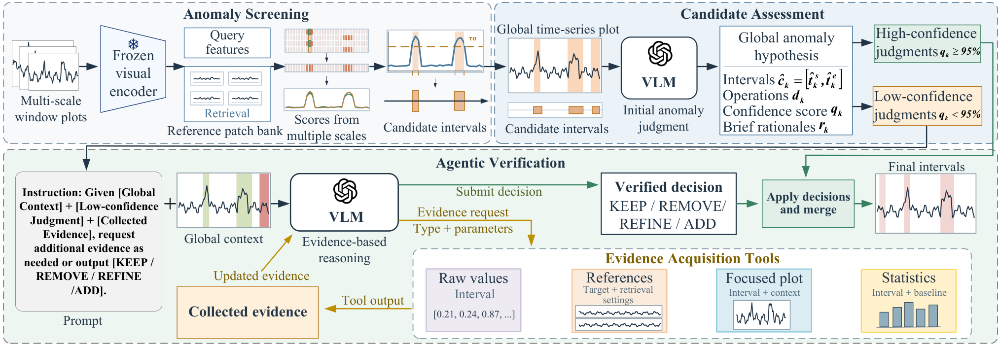
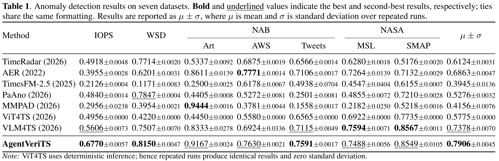

<h1 align="center">AgentVeriTS</h1>

<p align="center">
  <strong>Confidence-Guided Agentic Verification<br>for Time-Series Anomaly Detection</strong>
</p>

<p align="center">
  
  
</p>

AgentVeriTS detects anomalies in univariate time series through Anomaly Screening, Candidate Assessment, and Agentic Verification.

[](assets/mechanism-overview.png)

[](assets/main-results.png)

## Quick start

### 1. Install

Use Python 3.10 or 3.11. A CUDA-capable GPU is recommended for the visual encoder.

From the repository root:

```bash
python -m venv .venv
source .venv/bin/activate
python -m pip install -r requirements.txt
python -m pip install -e .
```

On Windows PowerShell, activate the environment with `.\.venv\Scripts\Activate.ps1` instead of `source`. For GPU support, use a compatible [PyTorch and torchvision installation](https://pytorch.org/get-started/locally/).

### 2. Prepare data

Datasets are downloaded separately. The default experiment uses the **252 signals** listed in [configs/signals_252.json](configs/signals_252.json).

| Datasets | Download source |
| :--- | :--- |
| IOPS, WSD | [TSB-AD datasets](https://github.com/thedatumorg/TSB-AD/blob/main/Datasets/README.md), using the univariate collection |
| artificialWithAnomaly, realAWSCloudwatch, realTweets, realAdExchange, realTraffic | [NAB](https://github.com/numenta/NAB) |
| MSL, SMAP | [NASA / Telemanom](https://github.com/khundman/telemanom#data) |

For the NAB and NASA datasets, the included downloader retrieves prepared CSVs and annotations from the [Orion data mirror](https://sintel-orion.s3.us-east-2.amazonaws.com):

```bash
python src/preprocessing/download_data.py MSL SMAP artificialWithAnomaly realAWSCloudwatch realTweets realAdExchange realTraffic
```

Download IOPS and WSD separately and place the selected files in `data/IOPS/` and `data/WSD/`. CSV filenames must match the full `signal_id` entries in the signal list.

Use one signal per CSV, with a header and a numeric `value` column. A `timestamp` column is optional. Rename the source signal column to `value` and retain a binary `label` column when available. For datasets with separate annotations, place them in `data/anomalies.csv`; the downloader provides this file for the mirrored datasets.

```csv
timestamp,value
0,0.12
1,0.15
2,0.91
```

The expected layout is:

```text
data/
├── anomalies.csv
├── IOPS/
├── WSD/
├── artificialWithAnomaly/
├── realAWSCloudwatch/
├── realTweets/
├── realAdExchange/
├── realTraffic/
├── MSL/
└── SMAP/
```

### 3. Set your API key

Use an official OpenAI API key:

```bash
export OPENAI_API_KEY="your-api-key"
```

Windows PowerShell:

```powershell
$env:OPENAI_API_KEY="your-api-key"
```

### 4. Run

```bash
python run_experiment.py
```

The default model is `gpt-5.6-sol` with `reasoning=high`. Set `--model MODEL_NAME` to a model available on your official OpenAI account. Pretrained OpenCLIP weights are downloaded on first use.

To specify data and output locations or run multiple signals concurrently:

```bash
python run_experiment.py --data-root data --output-root results/official_experiment --workers 3
```

Results, plots, and evidence records are saved under `results/official_experiment/`. Run the same command again to resume an interrupted experiment. Use `python run_experiment.py --help` to see the available options.
